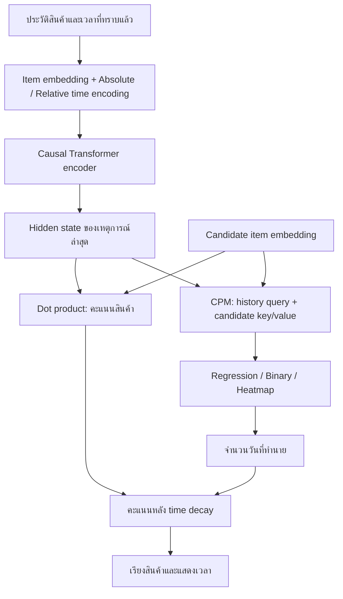

# อ่านและอธิบายโค้ด ITDRec ทีละส่วน

## ปัญหาที่โมเดลตอบ

สมมติผู้ใช้มีประวัติ `[อาหารแมว, ทรายแมว, อาหารแมว]` พร้อมวันที่เกิดแต่ละเหตุการณ์
โมเดลต้องตอบสองคำถาม:

- ผู้ใช้น่าจะมี interaction กับสินค้าอะไรต่อ?
- สำหรับสินค้าแต่ละตัว น่าจะเกิดอีกกี่วันนับจากเหตุการณ์ล่าสุด?

คำตอบข้อสองช่วยฝึก representation และปรับลำดับสินค้าในข้อแรก
เวลาจริงของอนาคตใช้เป็น label ตอนฝึกเท่านั้น



## 1. เริ่มที่ข้อมูล: data/dataset.py

`history_tensors()` ตัดเอาประวัติล่าสุดไม่เกิน `max_length` แล้วเติม padding ด้านขวา
เหตุผลที่ลบ timestamp ก่อนแปลง float32 คือ timestamp หลักล้านล้านอาจทำให้สูญเสีย
ความละเอียดของช่วงเวลาสั้น ๆ เมื่อแปลงชนิดตัวเลขเร็วเกินไป

ตัวอย่างประวัติ 3 เหตุการณ์และ `max_length=5`:

```text
items   = [12, 4, 9, 0, 0]
times   = [ 0, 2, 8, 0, 0]  # วันจากเหตุการณ์แรกของ window
lengths = 3
```

`TrainingDataset` เลือก prefix ที่จบก่อน train target ปัจจุบัน แล้วสุ่ม negatives
ตัวอย่างหนึ่งมี candidate แรกเป็น positive และอีกหลายตัวเป็น negative
เวลา positive คือ gap จริง (จำกัดไม่เกิน 365 วัน); negatives ใช้เวลาใหญ่กว่า horizon
ตามแนวคิดว่ายังไม่ใช่สินค้าที่ผู้ใช้จะสนใจในช่วงใกล้ ๆ

## 2. เวลาเป็นเวกเตอร์: models/time_encoding.py

`FunctionalTimeEncoding` รับจำนวนวันแล้วคำนวณ sin/cos ของความถี่ที่เรียนรู้ได้
จากค่าเวลา scalar หนึ่งตัวได้เวกเตอร์หลายมิติ เหมือนการมีหลายสเกลสำหรับมองเวลา
ค่าใกล้กันยังมี representation ที่เปลี่ยนอย่างต่อเนื่อง

ใน `encoder.py` มีเวลาสองมุมมอง:

```text
absolute = t - t_first  -> [ 0,  2, 8]
relative = t - t_recent -> [-8, -6, 0]
```

absolute แสดงระยะจากจุดเริ่ม window; relative แสดงความห่างจากเหตุการณ์ล่าสุด
จากนั้น concatenate กับ item embedding ไม่ได้บวกเวกเตอร์ทับกัน

## 3. อ่านประวัติ: models/encoder.py

Transformer รับ `[item | absolute | relative]` แล้วเรียนรู้ความสัมพันธ์ในประวัติ
causal mask ปิดการมอง token ด้านขวา และ padding mask ปิดช่องว่าง
โค้ดฝึกเฉพาะตัวอย่างที่สร้างจาก prefix ที่ทราบแล้ว

output มีขนาด `[B,L,D]` เลือกตำแหน่ง `lengths-1` เป็นเวกเตอร์สรุป prefix
อ่านเส้นทางนี้ได้จาก `ITDRec.encode()`

## 4. ให้คะแนนสินค้า: models/itdrec.py

```python
item_logits = (last_hidden[:, None, :item_dim] * candidate_embeddings).sum(-1)
```

นำส่วน item ของเวกเตอร์ประวัติคูณแบบ dot product กับ embedding ของแต่ละสินค้า
ได้คะแนน `[B,C]` โดย `C` คือจำนวน candidate ใน batch นั้น
สินค้าหลายตัวใช้ embedding table เดียวกันทั้งด้าน input และ output

## 5. เงื่อนไขของเวลาแยกตามสินค้า: models/cpm.py

ถ้าใช้ history เพียงอย่างเดียว โมเดลอาจให้เวลาเดียวกันกับทุกสินค้า
CPM จึงผสม encoded history กับ candidate embedding ก่อนส่งให้หัวทำนายเวลา
กำหนด query=history, key/value=candidate ตามทิศทางที่ paper ระบุ

implementation นี้คำนวณทีละ candidate ผ่านการ reshape ให้ทุกคู่กลายเป็น batch
จึงไม่ขึ้นกับว่ามีสินค้าอื่นอยู่ใน candidate list กี่ตัว
มีข้อจำกัดทางคณิตศาสตร์ของ singleton attention ที่อธิบายไว้ใน `PAPER_MAPPING.md`
ควรอธิบายว่า “ผสมประวัติเข้ากับสินค้าเป้าหมาย” ไม่อ้างว่ามันเลือกเหตุการณ์เก่าหลายตัวใน CPM เอง

## 6. แปลงเวกเตอร์เป็นเวลา: models/time_heads.py

| หัวทำนาย | Output ภายใน | Label / loss | แปลงกลับเป็นวัน |
|---|---|---|---|
| Regression | scalar ไม่ติดลบ | MSE ของ time/horizon | คูณ horizon |
| Binary | logits หลาย time bins | cumulative binary labels + BCE | boundary แรกที่ probability >= 0.5 |
| Heatmap | เวกเตอร์ความสูงหลาย bins | Gaussian prototype + MSE | เวลา ณ bin ที่สูงสุด |

ตัวอย่าง Binary มี boundaries `[2,4,6,8,10]` วัน และเหตุการณ์จริงวันที่ 3:
labels เป็น `[0,1,1,1,1]` เพราะตั้งแต่วันที่ 4 เป็นต้นไปถือว่าเหตุการณ์เกิดแล้ว
ถ้าเป็น negative ที่ 15 วัน labels จะเป็นศูนย์ทั้งหมด

Heatmap วาง Gaussian รอบเวลาจริง ให้ bin ใกล้เคียงยังมีเป้าหมายสูงบางส่วน
จึงไม่บังคับให้เวลาคลาดเพียงเล็กน้อยกลายเป็น class ที่ผิดทั้งหมด

## 7. ฝึกสองงานร่วมกัน: losses.py

```text
weighted_logit = item_logit * exp(-beta * label_days)
item_loss      = BCEWithLogits(weighted_logit, purchased_or_not)
total_loss     = item_loss + alpha * time_loss
```

`alpha` คุมอิทธิพลของงานเวลา; `beta` คุมความแรงของ decay หน่วยต่อวัน
time loss มีสเกลต่างกันตามหัวทำนาย จึงควร tune alpha เมื่อเปลี่ยน head
gradient วิ่งกลับไปถึง embedding, encoder, CPM และ time head

## 8. วัดผล: evaluate.py

ตอนทำนายเรียกเพียง:

```python
model(items, times, lengths, candidates)
```

ไม่มี `target_days` หรือ `labels` ใน model API
คะแนน rerank ใช้ `predicted_days` แทนเวลาอนาคตจริง แล้วคำนวณ:

- Hit@K: มี positive อย่างน้อยหนึ่งตัวใน K อันดับแรกหรือไม่
- Recall@K: พบ positive กี่ส่วนจาก positives ทั้ง cluster
- NDCG@K: ให้คะแนนสูงขึ้นเมื่อ positives อยู่ลำดับต้น
- Time MAE/RMSE: เวลาทำนายของ positive candidates ผิดจากจริงกี่วัน

`train.py` ใช้ validation เลือก checkpoint เท่านั้น แล้วรัน test หลังเลือกเสร็จ
`raw_...` เป็น metric ของ item logits ก่อน rerank ช่วยดูว่า temporal branch ช่วยจริงหรือไม่

## รูปร่าง tensor ที่ใช้บ่อย

| Tensor | Shape |
|---|---|
| history item IDs | `[B,L]` |
| history time offsets | `[B,L]` |
| candidate IDs | `[B,C]` |
| encoder hidden states | `[B,L,item_dim+2*time_dim]` |
| last hidden | `[B,item_dim+2*time_dim]` |
| candidate temporal representation | `[B,C,item_dim+2*time_dim]` |
| item logits / predicted days | `[B,C]` |
| binary / heatmap outputs | `[B,C,time_bins]` |

`B`=batch size, `L`=history length หลัง padding, `C`=candidate count

## แนวทางทดลองต่อ

เริ่มจาก `smoke.json` เพื่อเข้าใจ pipeline แล้วใช้ข้อมูลครบและ `pet.json`
ลองเปลี่ยน `predictor` โดยคง split/seed เดิมเพื่อเปรียบเทียบอย่างมีความหมาย
ถ้าจะวัดผลหลาย seed ให้รัน 0–4 แยก output directory แล้วรวมค่าเฉลี่ยและส่วนเบี่ยงเบนมาตรฐาน
พิจารณา raw ranking ควบคู่ reranked ranking และรายงาน cold positives ด้วย
การทดลองสั้น ๆ และข้อมูลผู้ใช้บางส่วนยังไม่เพียงพอจะสรุปประสิทธิภาพของ paper
